# Gallery

OpenTutor Guardian 0.5.0 as a user sees it on Windows. Real captures of the program's own
windows, made by `scripts/gallery.py` with throwaway data and a sample bank made of the 10 backup questions in `src/guardian/questions.py`.
The bank path in Ajustes is a neutral example, never a folder of the machine that made it.
The panel text is in Spanish. Regenerate after any interface change, from the repository root:

```
python scripts/gallery.py
```

Why it is versioned: `docs/decisions/0008-versioned-screenshot-gallery.md`.

## Hoy, first run

No session, no bank yet. The first-steps card says what to do.

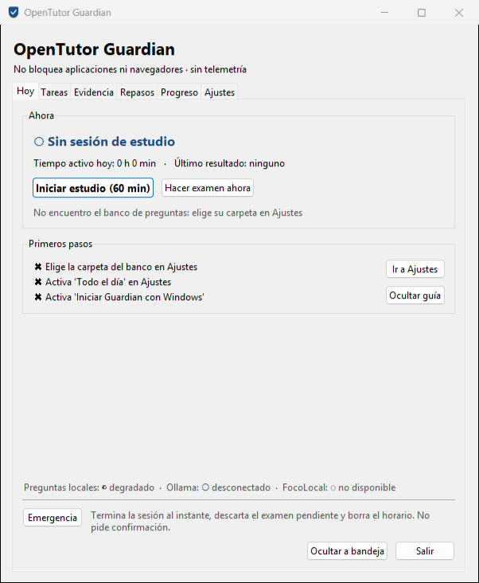

## Hoy, studying all day

All-day session, counter running.

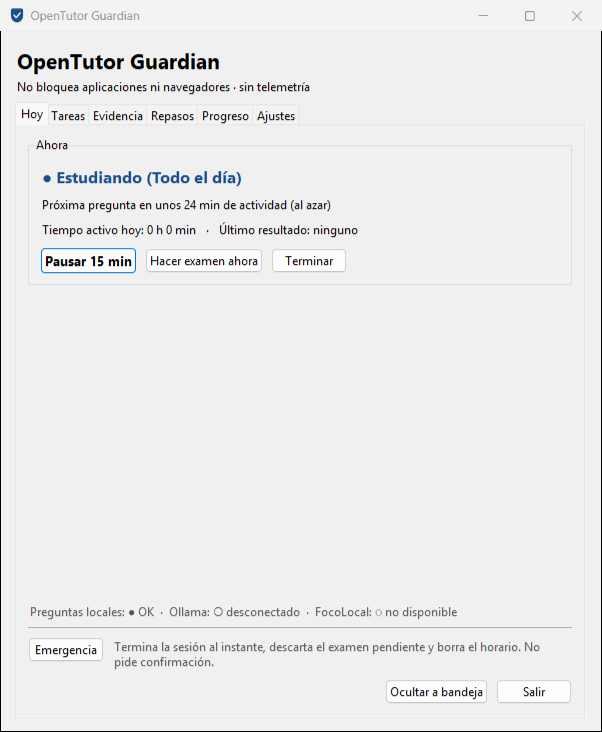

## Hoy, counter paused

The screen is locked, so no time is counted.

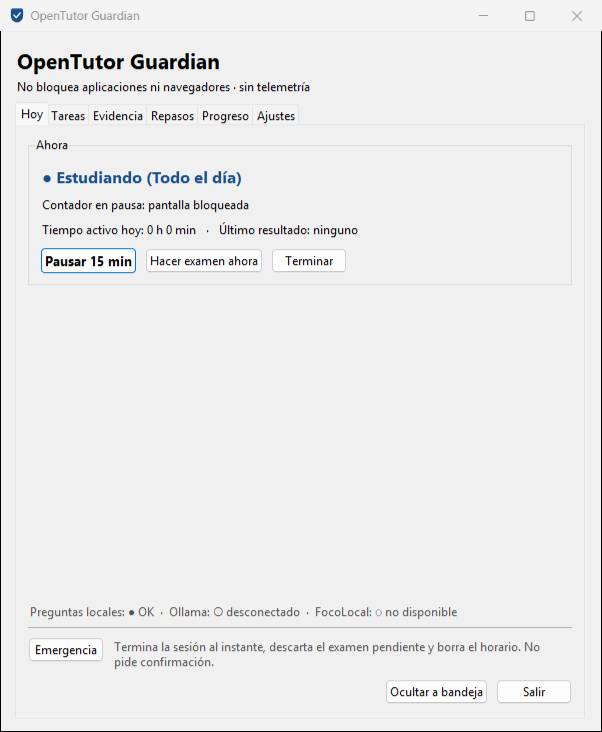

## Hoy, paused for 15 minutes

Pausar from the panel or the tray.

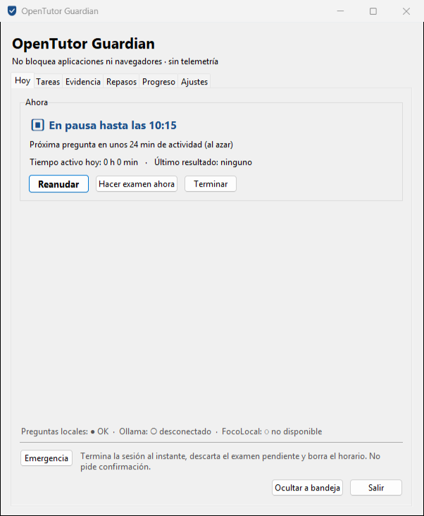

## Hoy, quiz waiting

A quiz is due but a full-screen app is open.

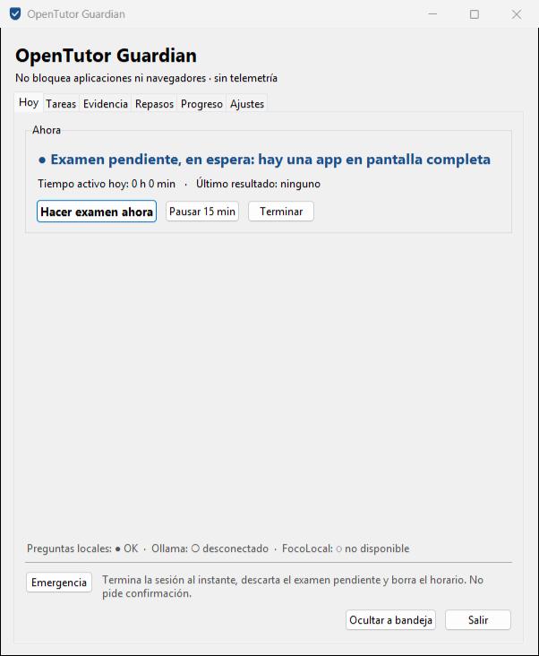

## Ajustes

Cuándo first, then Qué te pregunto. Changes save themselves.

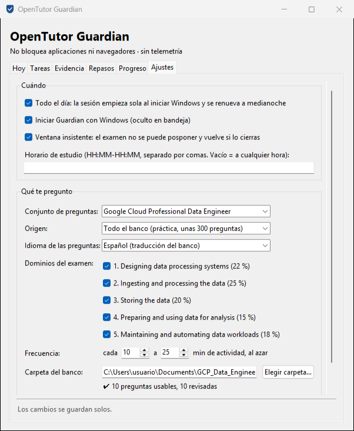

## Insistent quiz, just opened

Keys and clicks wait 2 s.

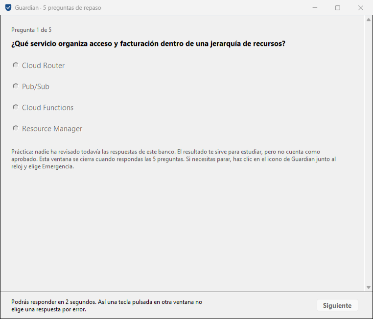

## Insistent quiz

No exit button. It comes back if closed.

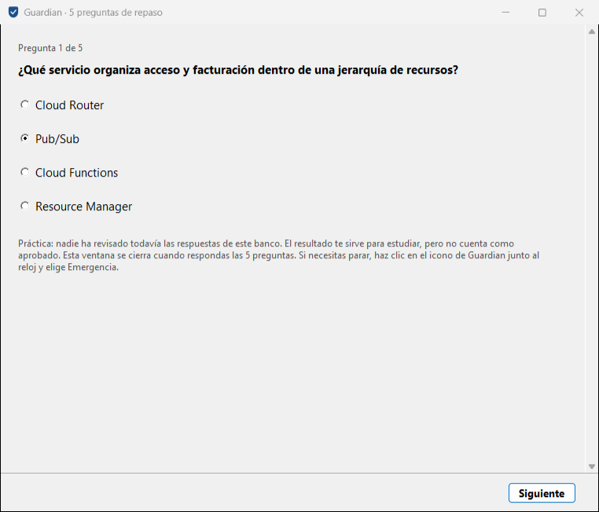

## Hoy, quiz open

The panel while the quiz is on screen.

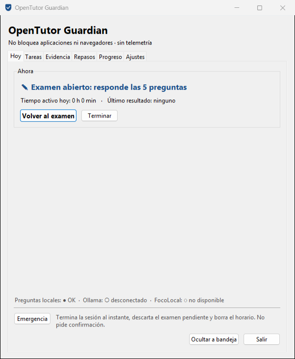

## Result review

One question at a time, with the right answer.

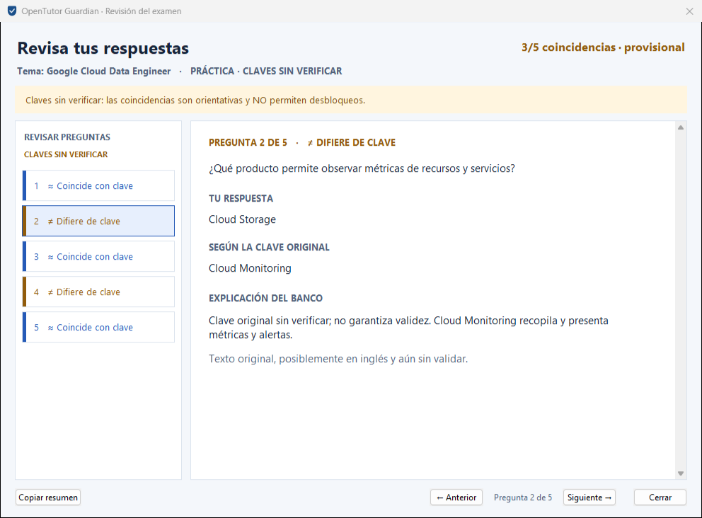

## Repasos

Pending quiz and recent results.

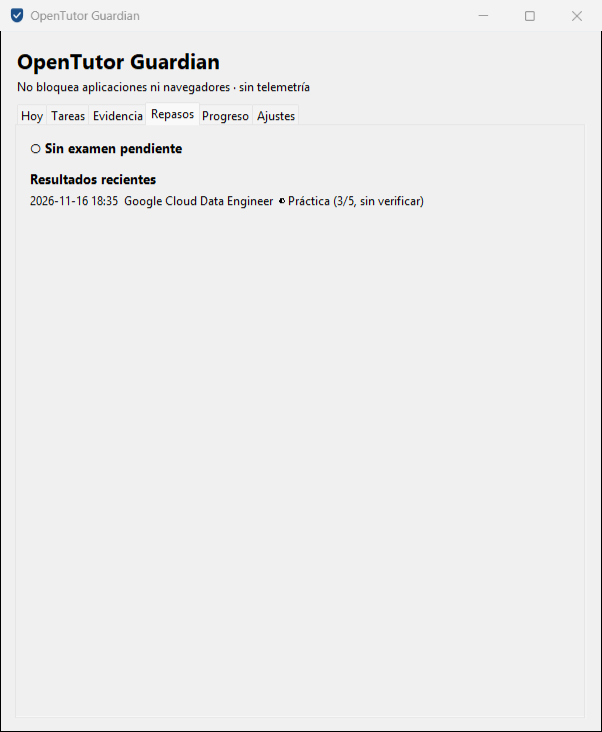

## Progreso

Totals and average.

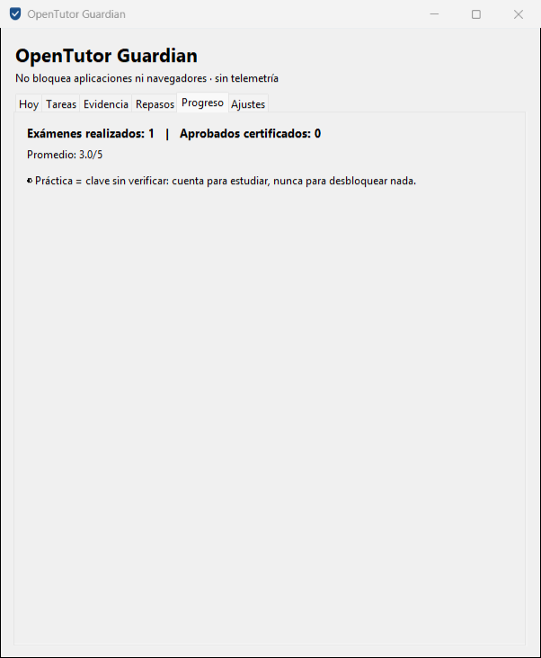

## Tareas

Practical tasks written by hand.

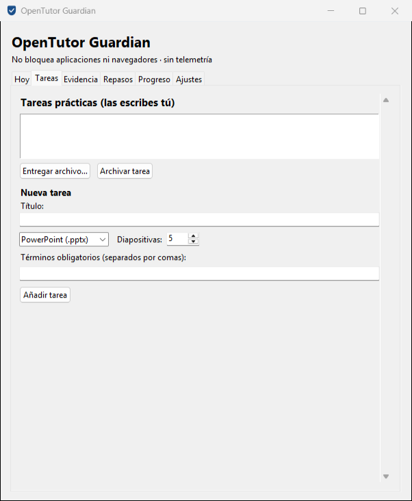

## Evidencia

Hand in a file and answer the defense.

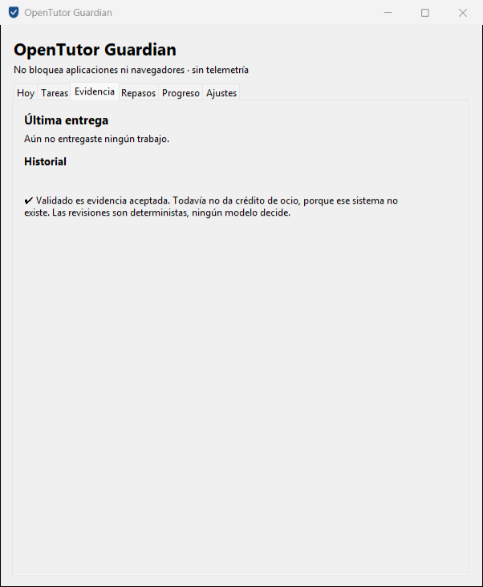

## Quiz with insistent mode off

It can be postponed.

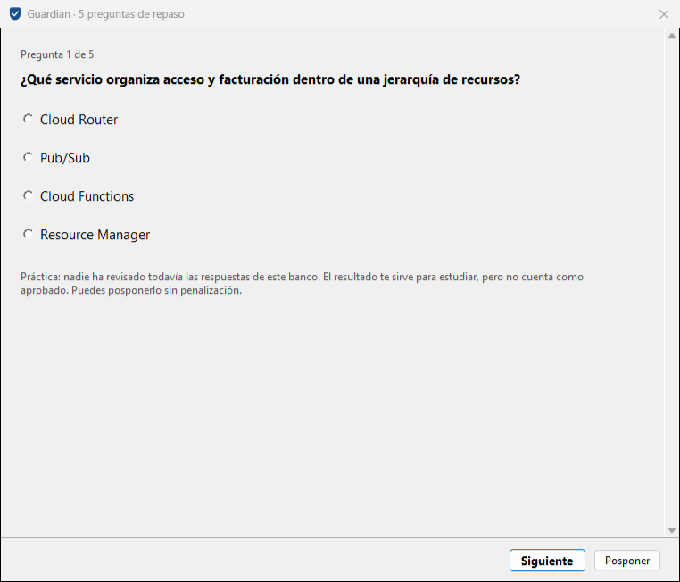

## Notice with insistent mode off

Small, does not take focus.

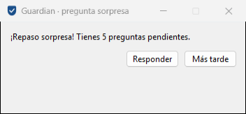
